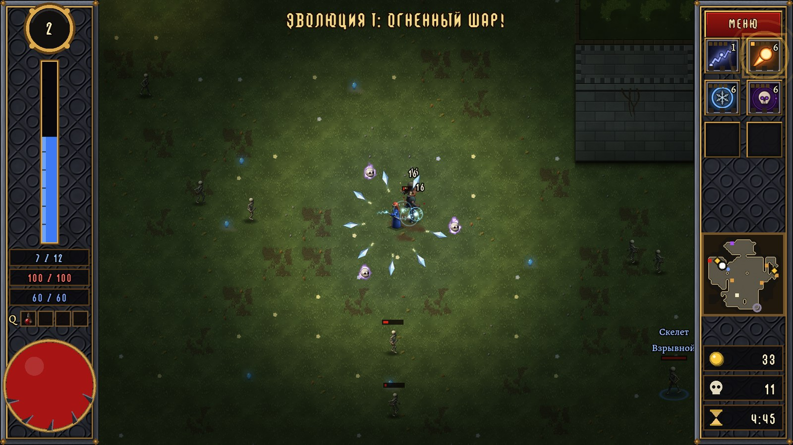
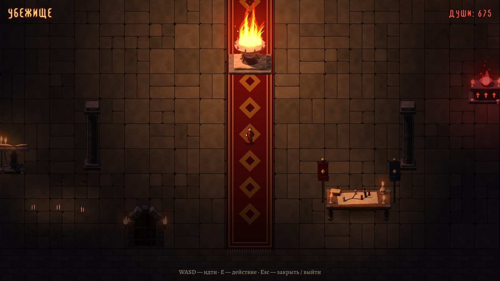
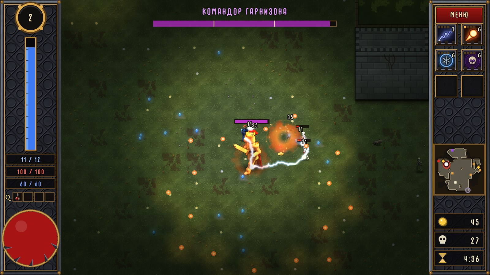
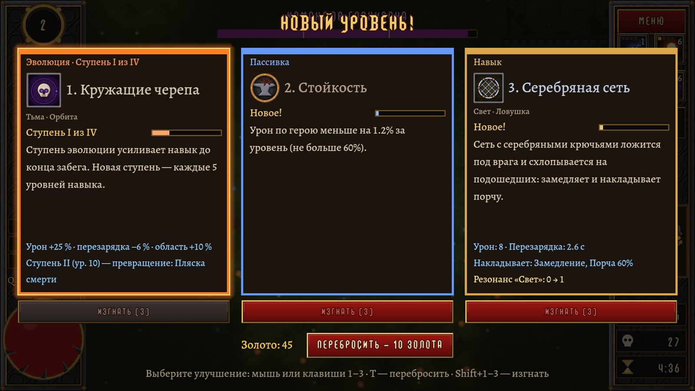

# Vault of Endless Rot

**Vault of Endless Rot** — 2D dark fantasy roguelike с видом сверху, боями против волн врагов и генерацией подземелий с помощью условного вариационного автокодировщика (CVAE). Проект объединяет две курсовые работы на одной игре.

## Скриншоты

| Забег в Проклятом лесу | Убежище |
| --- | --- |
|  |  |
| **Бой с командором гарнизона** | **Выбор улучшения при повышении уровня** |
|  |  |

## Как устроена игра

- **Убежище.** Здесь можно выбрать героя, потратить заработанные в забегах души на таланты, взять награды за задания и посмотреть рекорды, бестиарий и трофеи в «Летописи».
- **Забег.** Герой отбивает волны врагов, получает опыт и выбирает улучшения. Навыки усиливаются рунами, резонансами и эволюциями. Предметы, зелья, торговцы, испытания и тайники помогают собрать билд к встрече с боссом.
- **Биомы.** В забегах встречаются Проклятый лес, Затопленный склеп, Пылающий собор и Бездна. У каждого биома свой набор врагов, оформление и музыка. Сложность можно повысить режимом «Хардкор» и Печатями Скверны.
- **Кооператив.** Сетевая часть рассчитана на 2–4 игроков. Хост создаёт сессию, остальные подключаются по IP и порту. Отряд встречается в общем Убежище, а в забеге союзники могут воскрешать павших героев.

## Генерация уровней

Модель обучается в PyTorch на размеченных комнатах и экспортируется в ONNX. Игра запускает модель на CPU через C++-расширение для Godot и декодирует результат в сетку из 32 × 32 логических клеток. Валидатор обходом в ширину проверяет проходимость. При неудаче игра пробует новый сид и записывает результат в журнал генерации. В кооперативе хост передаёт клиентам готовую карту и её контрольную сумму.

## Запуск на Windows x64

1. Запустите стандартный Godot **4.7.2-stable** и импортируйте `game/project.godot`. Модель и DLL ONNX Runtime уже входят в проект.
2. Дождитесь импорта ресурсов и нажмите **F5**. В меню выберите «Начать», затем подойдите к Вратам Бездны в Убежище и нажмите **E**.

| Действие | Клавиши |
| --- | --- |
| Движение | W, A, S, D или стрелки |
| Взаимодействие | E |
| Зелье | Q |
| Герой, экипировка и навыки | I или Tab |
| Пауза | Esc или P |

Интерфейс доступен на русском и английском. Для экспорта установите шаблоны той же версии Godot и выберите пресет `Windows Desktop`.

## Сетевая игра

1. В главном меню выберите «Кооператив» → «Создать игру».
2. Другие игроки открывают «Кооператив», вводят IP и порт хоста и выбирают «Подключиться». Для двух окон на одном ПК укажите `127.0.0.1`. По умолчанию игра использует UDP-порт `24565`.
3. После подключения хост начинает забег у Врат Бездны. У всех участников должна быть одна версия игры.

Сессия работает на ENet через встроенный Multiplayer API Godot. Хост ведёт бой, создаёт объекты и отправляет карту, снимки врагов и события снарядов. Подробности и команды сетевой проверки есть в [документации модуля](game/net/README.md).

## Структура проекта

| Папка | Содержимое |
| --- | --- |
| [game/](game/) | Игровой код, сцены, ассеты, модель уровня и библиотека ONNX Runtime |

## Ассеты публичной сборки

Музыка, звуки интерфейса, тайлы Затопленного склепа и часть значков созданы процедурно. Готовые ассеты входят в Godot-проект.

- [Авторы музыки и звуков](game/assets/audio/CREDITS.txt)
- [Лицензия ONNX Runtime](game/addons/onnx_runtime/bin/LICENSE)

## Участники

| Участник | Часть проекта |
| --- | --- |
| К. А. Пономарёв | Игровые механики, датасет и генерация уровней с CVAE, интеграция ONNX Runtime |
| В. А. Ворончихин | Кооператив на ENet, лобби, синхронизация игрового мира, передача уровней и сетевые проверки |
